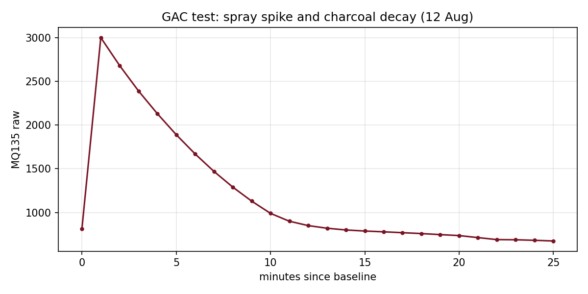
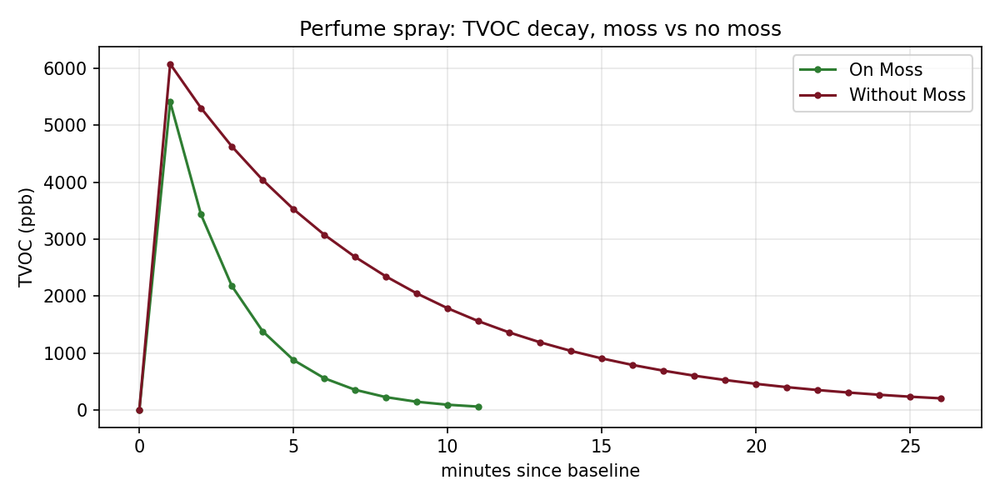

# AQI & VOC Monitoring and Reduction

A DIY, ESP32-based air quality monitor, used to test how different materials (activated charcoal, moss, zeolite and others) change indoor VOC, CO2 and particulate levels. Built for a TY BSc Physics field project (July to September 2026), Mumbai.

## What it measures

| Sensor | Measures | Interface |
|---|---|---|
| MQ135 | Raw gas/VOC response (uncalibrated, 12-bit ADC, max 4095) | Analog |
| SGP30 | TVOC (ppb), eCO2 (ppm) | I2C |
| SCD30 | CO2 (ppm), temperature, humidity (NDIR) | I2C |
| PM sensor (GP2Y1010) | PM2.5-style dust reading | Analog |
| DHT11 | Temperature and humidity (secondary) | Digital |

Board: DOIT ESP32 DEVKIT V1, programmed with the Arduino IDE. Readings are logged roughly every 35 s to Google Sheets through a Google Apps Script webhook, timestamped via NTP (IST).

## Experiments and data

| Test | Date | Sensor | Data | Figure |
|---|---|---|---|---|
| Occupied-room baseline (MQ135, PM, CO2, T, RH) | 12 Aug | MQ135, SCD30, PM | [csv](data/processed/room_aqi_voc_log.csv) | [png](figures/room_log.png) |
| Spray then granular activated carbon (GAC) | 12 Aug | MQ135 | [csv](data/processed/gac_test_mq135.csv) | [png](figures/gac_decay.png) |
| Incense stick, zeolite exposure | 4 Aug | MQ135 | [csv](data/processed/incense_test_mq135.csv) | [png](figures/incense.png) |
| Perfume on moss | 26 Sep | SGP30 | [csv](data/processed/perfume_on_moss_sgp30.csv) | [png](figures/perfume_moss_vs_none.png) |
| Perfume without moss | 26 Sep | SGP30 | [csv](data/processed/perfume_without_moss_sgp30.csv) | [png](figures/perfume_moss_vs_none.png) |

Raw spreadsheets are in `data/raw/`; write-ups are in `docs/`.




## Headline results

1. GAC: after a spray spike to 3000 (raw), the MQ135 fell back to the 814 baseline region in about 12 minutes and settled near 674 after 25 minutes.
2. Moss: TVOC from a perfume spray decayed to 57 ppb in 10 minutes with moss, versus 202 ppb after 25 minutes without moss.
3. Incense: smoke pushed the MQ135 to the ADC ceiling; readings fell after the stick was removed and the sensor was kept in zeolite.

## Known limitations (please read before reusing the data)

1. MQ135 values are raw ADC counts, not ppm. They drift during warm-up and depend on temperature and humidity.
2. Single runs, no replicates, no blank (empty-chamber) control for most tests. Treat these as demonstrations, not statistical proof.
3. Enclosure self-heating raised temperature and lowered humidity during long runs (see the room log), which can bias sensors.
4. The SGP30 columns in `data/raw/12th_aug_readings.xlsx` are all zero; the SGP30 was not reporting that day (a silent `begin()` failure or I2C conflict), so that session has no valid SGP30 data.
5. The incense sheet was transcribed from a handwritten notebook, so times are irregular. One value (4825) exceeds the 12-bit ADC maximum (4095) and is most likely a transcription or reading error; use it with caution.
6. SGP30 "absorption complete" was called when eCO2 returned to 400 ppm; TVOC had not fully reached zero at that moment.
7. A Bacillus subtilis trial ran but liquid culture may have inflated TVOC/CO2; the Spirulina culture did not grow, so there are no results for it.

## Reproduce the figures

```bash
pip install openpyxl matplotlib
python scripts/export_and_plot.py
```
Note: the published sketch (firmware/aqi_voc_logger) covers the SGP30 and dust sensor. MQ135 and SCD30 readings came from other sketch versions that are not included yet.

## Repository layout

```
data/raw/        original spreadsheets
data/processed/  one CSV per test
docs/            test write-ups (PDF, DOCX)
figures/         generated plots
firmware/        Arduino sketch (see firmware/README.md)
scripts/         export and plotting code
```

## Related

Hardware and live dashboard: https://github.com/sarahhhwhat/AQI-sensor-using-ESP32

## Licence

Code: MIT. Data, figures and write-ups: CC BY 4.0. See `LICENSE`.

## Acknowledgements

Guide: Dr. Nandini K.
Teammates: Uzma Mukhtar Ahmed, Suhani Sharma, Aamir Shaikh
Departments: Physics, Microbiology and Chemistry
